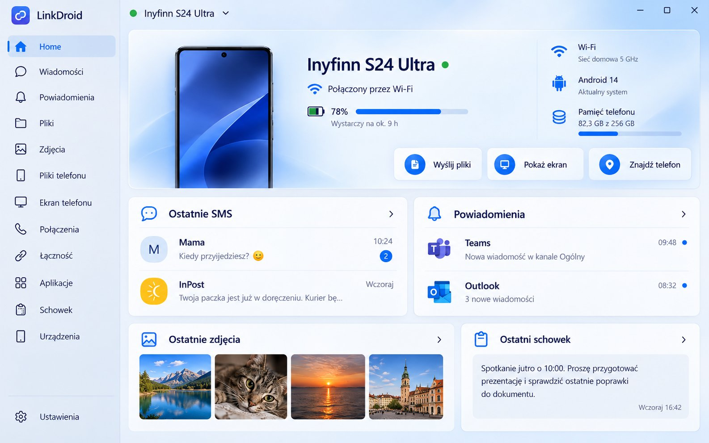
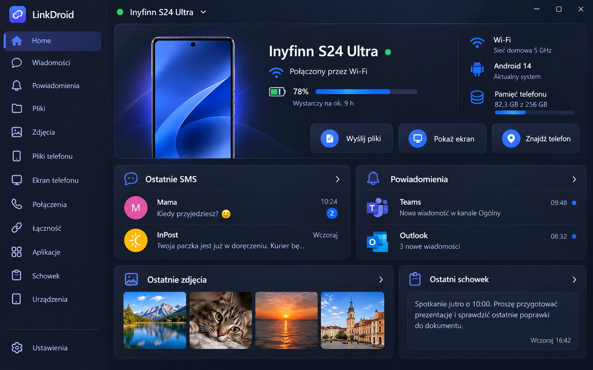
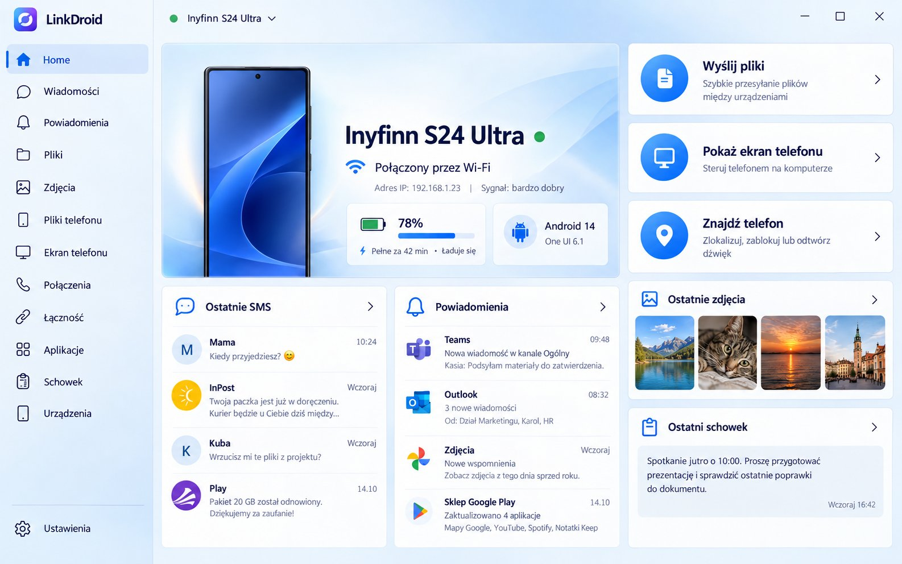
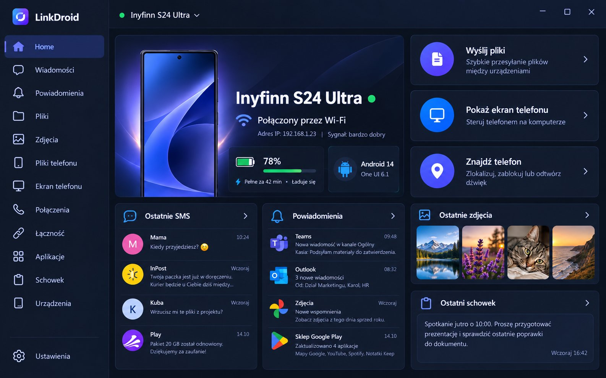
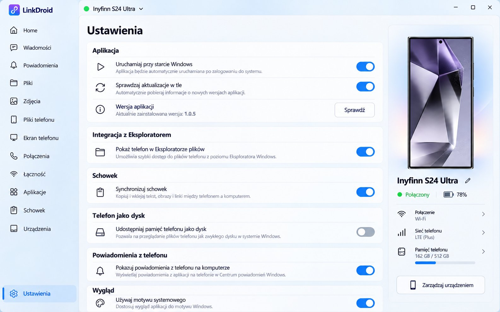
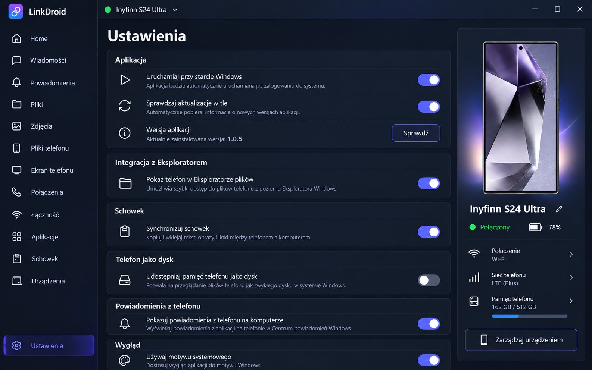

# LinkDroid

**Telefon z Androidem i komputer z Windows jako jedno urządzenie.** Wiadomości, powiadomienia, zdjęcia, pliki, schowek i ekran telefonu na komputerze, a pliki i ekran komputera na telefonie. Działa w domu przez Wi-Fi i poza domem przez internet albo dane komórkowe: samo, bez konta i bez konfiguracji.

  
  

## Pobierz

Najnowsza wersja jest w zakładce **[Releases](../../releases/latest)**:

- **Windows 10 i 11:** `LinkDroid_<wersja>_x64-setup.exe`. Jeden instalator, wszystko w środku.
- **Android 10 lub nowszy:** `LinkDroid-<wersja>.apk` (albo zeskanuj kod QR, który pokaże aplikacja na komputerze).

Po instalacji komputer pokazuje kod QR, telefon go skanuje i gotowe. Obie aplikacje same się aktualizują.

## Co potrafi

**Połączenie, które po prostu działa**
- W tej samej sieci Wi-Fi łączy się bezpośrednio i najszybciej.
- Gdy telefon jest na LTE albo w innej sieci, łączy się przez internet. Przełącza się samo, bez klikania, i samo wraca do Wi-Fi.
- Połączenie jest szyfrowane od końca do końca kluczami urządzeń. Nikt po drodze nie widzi treści.
- Licznik danych komórkowych pokazuje, ile LinkDroid zużył dziś przez LTE.
- Gdy połączenia nie ma, zaległe rzeczy (np. zrzut ekranu) czekają i dochodzą po ponownym połączeniu.
- Połączenie naprawia się samo: po błędzie, zmianie sieci albo odblokowaniu telefonu aplikacja łączy się ponownie, a przycisk „Połącz ponownie” jest zawsze pod ręką.

**Telefon na komputerze**
- **Wiadomości SMS:** czytanie i pisanie z klawiatury komputera.
- **Powiadomienia z telefonu:** w Windows, z przyciskiem „Kopiuj kod” przy kodach SMS i wyciszaniem wybranych aplikacji.
- **Połączenia:** wybieranie numeru z komputera i historia połączeń.
- **Zdjęcia i filmy:** przeglądanie, pobieranie, przeciąganie prosto do folderu.
- **Wiadomości z dużym „Kopiuj kod”:** kod jednorazowy wykrywany zawsze (także w czatach RCS), dowolny fragment wiadomości zaznaczasz i kopiujesz jak zwykły tekst, na komputerze i w telefonie.
- **Telefon jako dysk w Eksploratorze Windows:** własna litera dysku, miniatury, pojemność telefonu.
- **Ekran telefonu na komputerze ze sterowaniem myszą i klawiaturą,** także w pływającym oknie z ramką telefonu, które przesuwasz po pulpicie.
- **Zrzut ekranu z telefonu** od razu na komputerze: otwórz, zapisz, kopiuj, edytuj.
- **„Znajdź telefon”:** telefon dzwoni, nawet gdy jest wyciszony.

**Komputer na telefonie**
- **Pliki komputera:** wszystkie dyski (C:, D: i inne), z pobieraniem i zapisem.
- **Ekran komputera** na telefonie i proste sterowanie komputerem.
- **Zdjęcia w telefonie:** podgląd w aplikacji z przewijaniem, ulubione, edycja, udostępnianie; siatka zmieniana dwoma palcami.
- **Zgłoś problem:** formularz w Ustawieniach na komputerze i telefonie.
- **Karta komputera na telefonie:** na ekranie Start przesuwasz z karty telefonu na kartę komputera: rodzaj komputera, zalogowany użytkownik, bateria i ładowanie, sieć, godzina na komputerze, a pod nią przyciski Zablokuj, Uśpij, Wyłącz ekran, Steruj, Wyślij pliki, Wyłącz komputer.
- **Wybudzanie komputera z telefonu** (Wake-on-LAN): przycisk „Wybudź komputer”. Każdy inny włączony komputer z LinkDroid w tej samej sieci przekaże sygnał.

**Powiadomienia zawsze pod kontrolą**
- Odrzucasz w telefonie albo na komputerze: znika w obu miejscach i trafia do historii.
- Udostępnianie ekranu zawsze widać: w powiadomieniu i na ekranie Start jest przycisk „Zakończ udostępnianie ekranu”. Gdy komputer przestaje oglądać, udostępnianie kończy się samo.

**Razem**
- **Wspólny schowek:** tekst i obrazy kopiowane na jednym urządzeniu wklejasz na drugim.
- **Wysyłanie plików** w obie strony, z paskiem przeciągania na górze ekranu Windows.
- **Kilka komputerów naraz:** schowek idzie do wszystkich, przy wysyłce telefon pyta „Na który komputer?”.

**Most w sieci domowej**
- Mały program LinkDroid na stale włączonym urządzeniu w domu (np. Synology NAS w Dockerze) daje stały punkt połączenia i wybudza komputer, gdy jesteś poza domem. Paruje się przez komputer, bez skanowania kodów.

**Wygląd po Twojemu**
- Dwa układy ekranu głównego, motyw jasny i ciemny, cztery schematy kolorów.
- Na telefonie: motyw jasny lub ciemny jednym dotknięciem na górze ekranu Start, powiadomienia aktywne i historia przesuwane palcem.
- Tryb „Dostosuj”: sam wybierasz kafelki (SMS, powiadomienia jednej aplikacji, zdjęcia, filmy, pliki, połączenia, schowek). Ekran wypełnia się treścią na każdym monitorze, od laptopa po 4K.

  
  

  
  

## Czym różni się od „Łącza z telefonem”

| | LinkDroid | Łącze z telefonem |
|---|---|---|
| Konto | Niepotrzebne | Wymaga konta Microsoft |
| Twoje dane | Idą prosto między Twoimi urządzeniami, szyfrowane od końca do końca | Przez usługi Microsoft |
| Ekran telefonu i sterowanie | Każdy telefon z Androidem 10+ | Tylko wybrane modele (m.in. Samsung, Honor) |
| Pliki komputera na telefonie | Tak, wszystkie dyski, z zapisem | Nie |
| Wybudzenie komputera z telefonu | Tak | Nie |
| Telefon jako dysk w Eksploratorze | Tak, z literą dysku i miniaturami | Zależnie od wersji Windows |
| Wygląd | Dwa układy, schematy, tryb Dostosuj | Stały |
| Wybór, co widać na ekranie głównym | Tryb Dostosuj: kafelki SMS, powiadomienia jednej aplikacji, zdjęcia, filmy, pliki, połączenia, schowek | Stały układ |
| Most w sieci domowej (np. NAS) | Tak: stały punkt połączenia i wybudzanie komputera spoza domu | Nie |
| Stan komputera na telefonie (bateria, sieć, użytkownik) | Tak, karta Komputer na ekranie Start | Nie |
| Licznik danych komórkowych | Tak, „LinkDroid dziś: X MB” | Nie |
| Kilka komputerów naraz z jednym telefonem | Tak, schowek do wszystkich, wybór komputera przy wysyłce | Tak |
| Zrzut ekranu z telefonu na komputerze | Okno z podglądem: Otwórz, Zapisz, Kopiuj, Edytuj, Usuń z cofnięciem | Przez zdjęcia |

Porównanie dotyczy wersji „Łącza z telefonem” dostępnych w październiku 2026 i może się zmienić wraz z jego aktualizacjami.

## Prywatność

LinkDroid nie ma kont, serwera ani reklam. Urządzenia rozpoznają się po własnych kluczach. Gdy bezpośrednie połączenie przez internet nie jest możliwe, ruch idzie przez publiczny przekaźnik, ale jest zaszyfrowany i przekaźnik nie widzi treści.

---

Zrzuty pokazują wygląd aplikacji na przykładowych danych.
